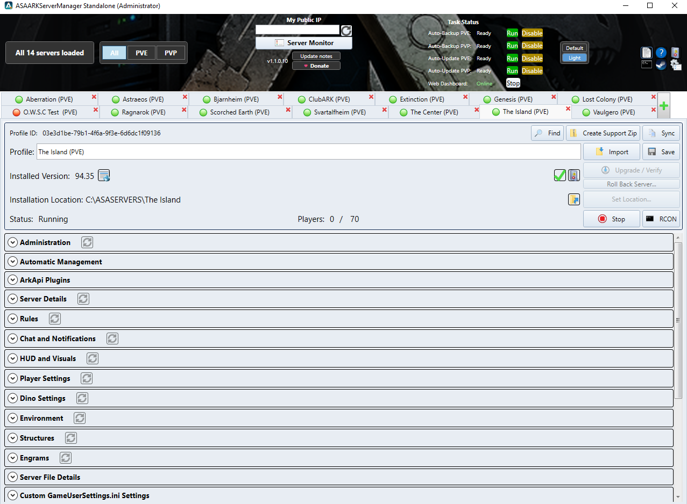
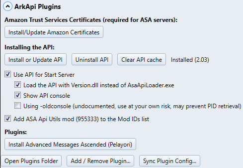
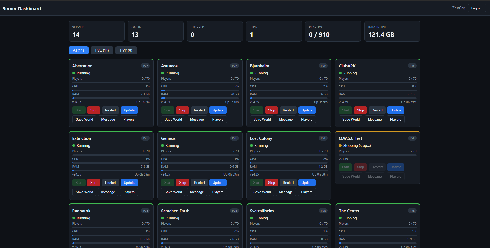

# ASAARKServerManager

A Windows server manager for **ARK: Survival Ascended** dedicated servers: profiles, settings, mods, backups, automatic
updates with a shutdown countdown, rollback to an older build, RCON, AsaApi support, a web dashboard and more.

## Download

Get the newest `ASAARKServerManager-Setup-Release.exe` from the
[Releases](https://github.com/jamakenjelly/ASAARKServerManager/releases/latest) page and run it. It asks for an install folder and makes
the shortcuts. Start the manager as administrator (the shortcut does this).

The manager checks this page for a newer version by itself and offers an upgrade button when there is one.

## Screenshots

**The manager** - all server profiles as tabs, Task Status for Auto Backup / Auto Update (PVE and PVP), Server Monitor, Default and Light themes.

**AsaApi** - install or update the API, clear its cache, choose the loader exe or Version.dll, plugins and plugin config sync.

**Web dashboard** - status, players, CPU and RAM of every server in a browser; Start / Stop / Restart / Update, Save World, Message and Players.

Set up in Global Settings: port, a login for each admin and an optional Discord login.

**Player profile backup** - each player profile is saved when a player connects and again when they disconnect; restore or delete a backup from the list.

## Notes

- Your settings, server profiles and servers stay in your own data folder and are not touched by an install or an upgrade.
- Rolling back to an older server build needs a Steam account that owns ASA (typed into the manager, never stored in the download).
- Not an official Studio Wildcard product. ARK: Survival Ascended must be obtained separately.

## Credits

This manager is built on the open-source ARK Server Manager project by its original authors and contributors:
https://github.com/Bletch1971/ServerManagers - thank you.
